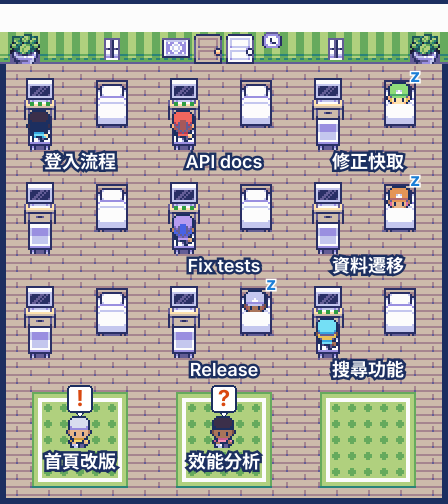

# session-room

English | [繁體中文](README.zh-TW.md)

A pane beside the chat that draws this project's Claude sessions as characters in a top-down pixel room. `/session-room` reopens it.



*Preview drawn by the mod's own `roomSvg` from made-up sessions. In the pane, a board and name buttons sit below the room.*

Requires the Claude desktop app on macOS: the room is SVG, which only the desktop surface draws (a terminal shows the board alone), and session titles and links come from the app's local files.

## Install

At the prompt of a terminal session:

```
/plugin install session-room --marketplace huan5678/session-room
```

Answer `y` to add the marketplace, then pick a scope. From a shell:

```bash
claude plugin install session-room --marketplace huan5678/session-room
```

In the desktop app, where `/plugin` does not run: click + next to the prompt box, then Plugins, Add marketplace with `huan5678/session-room`, then Add plugin.

## What it shows

| Session state | Character |
| --- | --- |
| working (`busy`) | at their own desk, back to us, typing dots |
| waiting on you | on a rug with a `!` (a prompt is open) or `?` (the last turn asked for input) |
| idle | asleep in their own bed |
| archived or process ended | walks out of the door, then gone |

Below the room, a board lists the same sessions in three columns: waiting on you, working, finished. Each card shows the session's title, short name, time and the app's summary of its last turn. Its `開啟` button, or the row of name buttons under the room, opens that session through the app's deep link (`claude://claude.ai/epitaxy/<id>`).

`選角色` under the room (or `/session-room-cast`) opens a pane to choose which of the 24 characters appear; the choice is kept across sessions. Sessions outnumbering the chosen characters repeat them.

## License

The code is under the [MIT License](LICENSE). The art is not: it is under CC BY 4.0, as below, including the sprites in `hooks/sprites.ts`, `assets/preview.svg` and `.claude-plugin/icon.png`.

## Credits and licenses

Every sprite comes from these packs through `assets/build_sprites.py` and is stored in `hooks/sprites.ts` as pixel-exact SVG paths, so the pane needs no bitmap. No other art is used; the floor colour, trim, bubbles and text are plain SVG.

| Pack | Author | License | Used for |
| --- | --- | --- | --- |
| [Small 8-direction Characters](https://axulart.itch.io/small-8-direction-characters) | AxulArt | [CC BY 4.0](https://creativecommons.org/licenses/by/4.0/) | every character |
| [AxulArt's Basic Top-down interior](https://axulart.itch.io/axularts-basic-top-down-interior) | AxulArt | [CC BY 4.0](https://creativecommons.org/licenses/by/4.0/) | the room and its furniture |

Modified or based on AxulArt's sprites. The changes: the 24 characters are recoloured from the Girl, Boy and Template sprites (the Template painted by region into hair, face and clothes), the furniture is cut from the sheet and composed into a room, and all of it is converted to SVG paths.

## Where the state comes from

The mod API has no list of other sessions, so the mod polls local files every 2 seconds through `$.fs` and `$.process`. These files are internal to Claude Code and the desktop app, not a documented API, and may change between releases:

- `~/.claude/sessions/<pid>.json`: `status` (`busy`, `idle`, `waiting`), `waitingFor`, `cwd`, `name`, `hostSessionId`. The `.key` files beside them are never read.
- `~/Library/Application Support/Claude/claude-code-sessions/*/*/local_*.json`: `title`, `isArchived`, `postTurnSummary`, `spawnedFrom.name`. Only those fields are kept. Only this project's live sessions are read, and only when a record changed.
- `ps -p <pids>`, every 6 seconds: drops status files whose process has died.

## Rebuild the sprites

```bash
python3 -I assets/build_sprites.py <characters sheet.png> <interior sheet.png> hooks/sprites.ts
```
