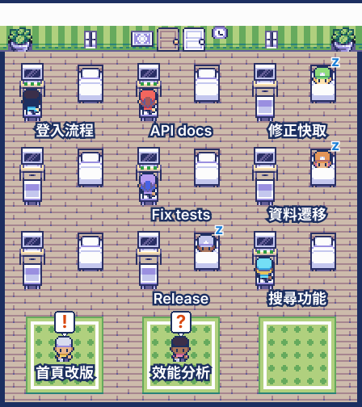

# session-room

[English](README.md) | 繁體中文

一個放在對話旁邊的 pane，把這個專案的 Claude sessions 畫成俯視像素房間裡的角色。用 `/session-room` 可以重新打開。



*預覽圖由 mod 自己的 `roomSvg` 用虛構的 sessions 畫出。實際的 pane 裡，房間下方還有看板和名字按鈕。*

需要 macOS 上的 Claude desktop app：房間是 SVG，只有 desktop 畫得出來（terminal 只會顯示看板），session 標題和連結也來自 app 的本機檔案。

## 安裝

在 terminal session 的輸入框輸入：

```
/plugin install session-room --marketplace huan5678/session-room
```

輸入 `y` 新增 marketplace，再選擇安裝範圍。或從 shell 執行：

```bash
claude plugin install session-room --marketplace huan5678/session-room
```

Desktop app 不能用 `/plugin`：按輸入框旁的 **+**，選 Plugins，用 `huan5678/session-room` 執行 Add marketplace，再按 Add plugin。

## 畫面內容

| Session 狀態 | 角色 |
| --- | --- |
| 工作中（`busy`） | 在自己的機台前，有打字的跳動點 |
| 等你 | 在警示帶區，頭上有 `!`（有提示框開著）或 `?`（上一輪要求你輸入） |
| 閒置 | 在自己的長椅上睡覺 |
| 已封存或程序已結束 | 走出門後消失 |

房間下方的看板用三欄列出同樣的 sessions：等你回覆、工作中、做完了。每張卡片顯示 session 的標題、短名、時間和 app 對上一輪的摘要。按卡片的 `開啟`，或房間下方那排名字按鈕，會透過 app 的深層連結（`claude://claude.ai/epitaxy/<id>`）開啟該 session。

房間下方的 `選角色`（或 `/session-room-cast`）會打開一個 pane，讓你從 24 個角色裡選擇要出現的角色，選擇會跨 session 保存。Session 比選到的角色多時，角色會重複出現。

## 授權

程式碼採用 [MIT License](LICENSE)。美術素材維持 CC0，詳見下方。

## 素材來源與授權

所有圖像都由 `assets/build_sprites.py` 從以下素材包裁切，並以逐像素的 SVG path 存在 `hooks/sprites.ts`，所以 pane 不需要點陣圖。沒有使用其他美術素材；地板顏色、邊框、泡泡和文字都是純 SVG。

| 素材包 | 版本 | 作者 | 授權 | 用途 |
| --- | --- | --- | --- | --- |
| [Tiny Factory](https://kenney.nl/assets/tiny-factory) | 1.0 | Kenney (www.kenney.nl) | [CC0 1.0](http://creativecommons.org/publicdomain/zero/1.0/) | 整個場景、工人角色 |
| [Tiny Dungeon](https://kenney.nl/assets/tiny-dungeon) | 1.0 | Kenney (www.kenney.nl) | [CC0 1.0](http://creativecommons.org/publicdomain/zero/1.0/) | 角色 |
| [Tiny City](https://kenney.nl/assets/tiny-city) | 1.0 | Kenney (www.kenney.nl) | [CC0 1.0](http://creativecommons.org/publicdomain/zero/1.0/) | 角色 |
| [Tiny Farm](https://kenney.nl/assets/tiny-farm) | 1.0 | Kenney (www.kenney.nl) | [CC0 1.0](http://creativecommons.org/publicdomain/zero/1.0/) | 角色 |
| [Tiny Ski](https://kenney.nl/assets/tiny-ski) | 1.0 | Kenney (www.kenney.nl) | [CC0 1.0](http://creativecommons.org/publicdomain/zero/1.0/) | 雪怪角色 |

各素材包的 `License.txt` 都寫著：「This content is free to use in personal, educational and commercial projects. Support us by crediting Kenney or www.kenney.nl (this is not mandatory)」。標註來源並非必要，這裡仍然列出。

## 狀態來源

Mod API 沒有提供其他 session 的清單，所以這個 mod 每 2 秒透過 `$.fs` 和 `$.process` 輪詢本機檔案。這些檔案是 Claude Code 和 desktop app 的內部檔案，不是公開文件記載的 API，可能隨版本改變：

- `~/.claude/sessions/<pid>.json`：`status`（`busy`、`idle`、`waiting`）、`waitingFor`、`cwd`、`name`、`hostSessionId`。旁邊的 `.key` 檔案一律不讀。
- `~/Library/Application Support/Claude/claude-code-sessions/*/*/local_*.json`：`title`、`isArchived`、`postTurnSummary`、`spawnedFrom.name`。只保留這些欄位，也只讀這個專案執行中的 sessions，而且只在紀錄有變動時才讀。
- `ps -p <pids>`，每 6 秒一次：移除程序已結束的狀態檔。

## 重新產生圖像

```bash
python3 -I assets/build_sprites.py <存放已解壓 pack-tiny-* 資料夾的資料夾> hooks/sprites.ts
```
